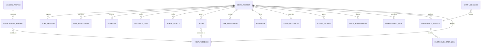

# ZeroG Vitals: modelo de datos y lógica de negocio de persistencia

> **Complementa la sección 4.4 del SPEC** y tiene la misma prioridad que el SPEC. Si hay diferencia en tablas o campos, **manda este documento**.
> Base de datos: PostgreSQL 16. Migraciones: Flyway. Acceso: Spring Data JPA.
> **Regla de oro:** la base de datos **guarda y protege la integridad**. Las **decisiones de salud** (niveles, alertas, puntos) las toma el `service`, que usa el `domain`. **Nunca** se programan con triggers ni procedimientos almacenados.

---

## 1. Principios

| # | Principio | Cómo se aplica |
|---|---|---|
| P1 | **Los datos de salud solo se agregan** | Lecturas, autoevaluaciones, síntomas, pruebas, resultados de triaje y pasos de emergencia **no se editan ni se borran** por la API. Una corrección es un registro nuevo. Una lectura errónea se marca con `is_valid = false`, no se borra |
| P2 | **Momentos en UTC; "día" en hora de misión** | Columnas `TIMESTAMPTZ` con sufijo `_at` (UTC). La hora de misión (UTC en la estación y en tránsito; sol marciano en Marte) se **calcula** en la app (SPEC 4.3b). Los conteos "por día" (rachas, días sin descanso, autoevaluación diaria) usan el **día de misión**, que empieza al despertar del tripulante, nunca la medianoche UTC |
| P3 | **La unidad va en el nombre** | `heart_rate_bpm`, `spo2_percent`, `glucose_mg_dl`… (snake_case en la BD y camelCase en Java) |
| P4 | **Enums como texto** | `VARCHAR` con `CHECK (col IN (...))` en la BD + `@Enumerated(EnumType.STRING)` en JPA |
| P5 | **Rangos físicamente posibles en la BD; rangos clínicos nunca** | La BD y los DTOs rechazan lo **imposible** (por ejemplo, SpO₂ = 140). Que un valor sea "peligroso" lo decide el triaje con `thresholds.json` |
| P6 | **Sin borrado físico** | Un tripulante se desactiva con `active = false`. Nada de `DELETE` en tablas de salud |
| P7 | **El esquema es de Flyway** | `spring.jpa.hibernate.ddl-auto=validate`. Cada cambio es una migración nueva; las ya aplicadas nunca se editan |
| P8 | **IDs** | `BIGINT GENERATED BY DEFAULT AS IDENTITY` (en JPA: `@GeneratedValue(strategy = GenerationType.IDENTITY)`). Las FK son `BIGINT` y **siempre con índice** (PostgreSQL no indexa las FK por sí solo). Las tablas que el frontend puede llenar sin conexión llevan además `client_ref UUID UNIQUE` para no duplicar registros al reenviar la cola (BR-22) |

---

## 2. Diagrama entidad-relación



---

## 3. Tablas

> **Nul.** = acepta NULL. Los rangos de los `CHECK` son **físicamente posibles** (P5), no clínicos.

### 3.1 `habitat_module`
| Columna | Tipo | Nul. | Reglas |
|---|---|---|---|
| id | BIGINT PK | No | — |
| code | VARCHAR(40) | No | UNIQUE (por ejemplo, `HAB-A`, `LAB`, `SHELTER`, `ROVER-1`) |
| name | VARCHAR(80) | No | — |
| is_shelter | BOOLEAN | No | DEFAULT false. El refugio de radiación (P3) |

### 3.2 `mission_profile`
| Columna | Tipo | Nul. | Reglas |
|---|---|---|---|
| id | BIGINT PK | No | — |
| code | VARCHAR(30) | No | UNIQUE · CHECK IN (`STATION`, `LUNAR_TRANSIT`, `LUNAR_BASE`, `MARS_TRANSIT`, `MARS_BASE`, `ROVER`) |
| name | VARCHAR(80) | No | — |
| gravity_g | NUMERIC(4,2) | No | CHECK 0–1.5 |
| comm_delay_seconds | INTEGER | No | CHECK 0–1500 |
| evacuation_time | VARCHAR(40) | No | Texto ("horas", "~3 días", "imposible") |
| radiation_factor_vs_iss | NUMERIC(4,2) | No | CHECK 0–10 |
| cabin_pressure | VARCHAR(10) | No | CHECK IN (`NORMAL`, `REDUCED`) |
| day_length_hours | NUMERIC(7,4) | No | 24.0000 o 24.6597 (Marte) |
| medical_equipment | JSONB | No | Lista de códigos de equipo |
| mission_epoch_at | TIMESTAMPTZ | Sí | Inicio de la misión o aterrizaje: base para contar el "Día N" o el "Sol N" |
| active | BOOLEAN | No | DEFAULT false · **índice único parcial `WHERE active = true`** → **solo un perfil activo** (BR-07) |

### 3.3 `crew_member`
| Columna | Tipo | Nul. | Reglas |
|---|---|---|---|
| id | BIGINT PK | No | — |
| name | VARCHAR(80) | No | — |
| mission_role | VARCHAR(40) | No | "Comandante", "Ingeniera de vuelo"… |
| agency | VARCHAR(20) | Sí | NASA, ESA, CSA, JAXA, AEB… (demo multinacional) |
| is_cmo | BOOLEAN | No | DEFAULT false · **índice único parcial `WHERE is_cmo = true AND active = true`** → **un solo CMO activo** |
| age_years | SMALLINT | No | CHECK 18–80 |
| sex | VARCHAR(10) | No | CHECK IN (`MALE`, `FEMALE`) (lo necesita la ecuación EER de la NASA) |
| body_mass_kg | NUMERIC(5,1) | No | CHECK 30–200 |
| height_m | NUMERIC(3,2) | No | CHECK 1.40–2.20 |
| activity_factor | NUMERIC(3,2) | No | CHECK 1.0–2.5 (EER) |
| current_module_id | BIGINT FK → habitat_module | No | — |
| career_dose_msv | NUMERIC(8,3) | No | DEFAULT 0 · CHECK ≥ 0 · **solo aumenta** (BR-09) |
| mission_dose_msv | NUMERIC(8,3) | No | DEFAULT 0 · CHECK ≥ 0 |
| baseline_heart_rate_bpm | NUMERIC(5,1) | Sí | Línea base (BR-10) |
| baseline_systolic_mm_hg / baseline_diastolic_mm_hg | NUMERIC(5,1) | Sí | — |
| baseline_spo2_percent | NUMERIC(4,1) | Sí | — |
| baseline_body_temperature_celsius | NUMERIC(4,2) | Sí | — |
| baseline_respiratory_rate_rpm | NUMERIC(4,1) | Sí | — |
| baseline_hrv_rmssd_ms | NUMERIC(6,1) | Sí | — |
| baseline_vigilance_median_ms / baseline_vigilance_lapses | NUMERIC(6,1) / NUMERIC(4,1) | Sí | Línea base de D11 |
| baseline_source | VARCHAR(10) | No | DEFAULT `PENDING` · CHECK IN (`PENDING`, `AUTO`, `MANUAL`) |
| baseline_updated_at | TIMESTAMPTZ | Sí | — |
| sleep_start_time | TIME | No | DEFAULT '22:00' · inicio del sueño en **hora de misión** (para el nadir circadiano y los recordatorios) |
| sleep_duration_hours | NUMERIC(3,1) | No | DEFAULT 8.5 (NASA-STD-3001, V1 6001) |
| photo_url | VARCHAR(255) | Sí | Para el selector |
| active | BOOLEAN | No | DEFAULT true (P6) |
| pin_hash | VARCHAR(100) | Sí | Solo si se hace el PIN (Should). BCrypt |
| created_at | TIMESTAMPTZ | No | DEFAULT now() |

### 3.4 `vital_reading`
| Columna | Tipo | Nul. | Reglas (físicamente posibles) |
|---|---|---|---|
| id | BIGINT PK | No | — |
| crew_member_id | BIGINT FK | No | — |
| recorded_at | TIMESTAMPTZ | No | No puede estar en el futuro (BR-19, en el service) |
| heart_rate_bpm | SMALLINT | Sí | 20–250 |
| hrv_rmssd_ms | NUMERIC(6,1) | Sí | 0–300 |
| systolic_mm_hg | SMALLINT | Sí | 50–260 |
| diastolic_mm_hg | SMALLINT | Sí | 30–160 · **CHECK diastolic < systolic** si ambos existen |
| spo2_percent | NUMERIC(4,1) | Sí | 50–100 |
| body_temperature_celsius | NUMERIC(4,2) | Sí | 30–43 |
| respiratory_rate_rpm | SMALLINT | Sí | 4–60 |
| glucose_mg_dl | SMALLINT | Sí | 20–600 |
| glucose_context | VARCHAR(10) | Sí | CHECK IN (`FASTING`, `POST_MEAL`, `RANDOM`) · **obligatorio si hay glucosa** (CHECK, BR-04) |
| posture | VARCHAR(10) | Sí | CHECK IN (`LYING`, `SITTING`, `STANDING`, `FLOATING`) (prueba ortostática) |
| source | VARCHAR(15) | No | CHECK IN (`SENSOR`, `GUIDED_MANUAL`, `SIMULATED`) |
| is_valid | BOOLEAN | No | DEFAULT true · false = posible error de sensor (regla L2) |
| created_at | TIMESTAMPTZ | No | DEFAULT now() |
| **CHECK** | — | — | **Al menos una medición no nula** (BR-03) |

### 3.5 `environment_reading`
| Columna | Tipo | Nul. | Reglas |
|---|---|---|---|
| id | BIGINT PK | No | — |
| module_id | BIGINT FK → habitat_module | No | — |
| recorded_at | TIMESTAMPTZ | No | — |
| co2_partial_pressure_mm_hg | NUMERIC(5,2) | Sí | 0–40 |
| cabin_temperature_celsius | NUMERIC(4,1) | Sí | 0–50 |
| cabin_humidity_percent | NUMERIC(4,1) | Sí | 0–100 |
| radiation_dose_rate_msv_per_day | NUMERIC(8,3) | Sí | 0–1000 |
| solar_event_active | BOOLEAN | No | DEFAULT false |
| source | VARCHAR(15) | No | `SENSOR` o `SIMULATED` |

### 3.6 `self_assessment`
| Columna | Tipo | Nul. | Reglas |
|---|---|---|---|
| id, crew_member_id, recorded_at | — | No | — |
| sleep_hours | NUMERIC(3,1) | Sí | 0–24 |
| hours_awake | NUMERIC(3,1) | Sí | 0–72 (factor de fatiga: > 16 h) |
| work_hours | NUMERIC(3,1) | Sí | 0–24 (factor de fatiga: > 12 h) |
| mood | SMALLINT | Sí | 1–5 |
| morale | SMALLINT | Sí | 1–5 |
| fatigue | SMALLINT | Sí | 1–10 |
| stress | SMALLINT | Sí | 1–10 |
| bedford_workload | SMALLINT | Sí | 1–10 (escala NASA) |
| bored | BOOLEAN | Sí | — |
| exercise_minutes | SMALLINT | Sí | 0–600 |
| hydration_liters | NUMERIC(3,1) | Sí | 0–10 |
| calories_kcal | SMALLINT | Sí | 0–10000 |
| appetite | SMALLINT | Sí | 1–5 |
| dizziness_grade | SMALLINT | Sí | 0–3 (escala NASA) |
| vision_change | BOOLEAN | Sí | — |
| caffeine_last_at | TIMESTAMPTZ | Sí | Could |
| notes | VARCHAR(500) | Sí | La bitácora va en una tabla aparte si se implementa |
| **CHECK** | — | — | Al menos un campo no nulo |

### 3.7 `symptom`
| Columna | Tipo | Nul. | Reglas |
|---|---|---|---|
| id, crew_member_id, recorded_at | — | No | — |
| body_region | VARCHAR(15) | No | CHECK IN (`MIND`, `EYES`, `INNER_EAR`, `HEART`, `LUNGS`, `BLOOD`, `BONES`, `MUSCLES`, `SPINE`, `KIDNEYS`, `WHOLE_BODY`) |
| intensity | SMALLINT | No | 0–10 |
| type | VARCHAR(20) | No | CHECK IN (`PRESSURE`, `STABBING`, `BURNING`, `CRAMPING`, `TINGLING`, `ITCHING`, `SWELLING`, `RASH`, `BLISTERS`, `NAUSEA`, `OTHER`) |
| onset_at | TIMESTAMPTZ | Sí | — |
| associated | JSONB | No | DEFAULT '[]' · por ejemplo, `["SHORTNESS_OF_BREATH","SWEATING","NAUSEA","DIZZINESS","WEAKNESS_ONE_SIDE"]` |
| context | VARCHAR(20) | No | DEFAULT `GENERAL` · CHECK IN (`GENERAL`, `POST_EVA`, `POST_SOLAR_EVENT`, `POST_LANDING`) |
| resolved_at | TIMESTAMPTZ | Sí | Único campo que se puede actualizar (marcar como resuelto) |

### 3.8 `vigilance_test` (D11)
| Columna | Tipo | Nul. | Reglas |
|---|---|---|---|
| id, crew_member_id, recorded_at | — | No | — |
| context | VARCHAR(15) | No | CHECK IN (`POST_SLEEP`, `PRE_SLEEP`, `PRE_EVA`, `POST_EVA`, `ADHOC`) (formato NASA, S32) |
| duration_seconds | SMALLINT | No | DEFAULT 180 |
| stimuli_count | SMALLINT | No | ≥ 1 |
| median_reaction_ms | NUMERIC(6,1) | No | 100–5000 |
| lapses | SMALLINT | No | ≥ 0 |
| false_starts | SMALLINT | No | ≥ 0 |
| lapse_threshold_ms | SMALLINT | No | Se guarda el umbral usado (`CMO_CONFIGURABLE`) |
| score_percent | NUMERIC(5,1) | No | 0–100, frente a la línea base |

### 3.9 `triage_result`
| Columna | Tipo | Nul. | Reglas |
|---|---|---|---|
| id, crew_member_id | — | No | — |
| evaluated_at | TIMESTAMPTZ | No | — |
| trigger_type | VARCHAR(20) | No | CHECK IN (`VITAL_READING`, `ENVIRONMENT`, `SELF_ASSESSMENT`, `SYMPTOM`, `VIGILANCE`, `PROFILE_CHANGE`, `SCHEDULED`) |
| trigger_id | BIGINT | Sí | ID del registro que lo disparó |
| mission_profile_code | VARCHAR(30) | No | El perfil activo al momento de evaluar (para auditoría) |
| global_level | VARCHAR(10) | No | CHECK IN (`NORMAL`, `CAUTION`, `ALERT`, `CRITICAL`, `NO_DATA`) |
| escalation | VARCHAR(15) | No | CHECK IN (`NONE`, `SELF`, `CREW_CMO`, `FLIGHT_SURGEON`) |
| levels_by_indicator | JSONB | No | `{ "SPO2": "CAUTION", … }` |
| body_status | JSONB | No | `{ "LUNGS": "CAUTION", … }` |
| traces | JSONB | No | Lista de `RuleTrace` (D1) |
| recommendations | JSONB | No | Hasta 3 códigos de contramedida o de mensaje |
| wellness_score | SMALLINT | No | 0–100 |
| rules_version | VARCHAR(20) | No | Versión de `thresholds.json` usada (auditoría) |

### 3.10 `alert`
| Columna | Tipo | Nul. | Reglas |
|---|---|---|---|
| id | BIGINT PK | No | — |
| crew_member_id | BIGINT FK | Sí | — |
| module_id | BIGINT FK | Sí | — |
| **CHECK** | — | — | **Exactamente uno** de `crew_member_id` o `module_id` (BR-06) |
| indicator | VARCHAR(30) | No | Código de `Indicator` |
| level | VARCHAR(10) | No | `CAUTION`, `ALERT` o `CRITICAL` |
| escalation | VARCHAR(15) | No | — |
| message_code | VARCHAR(60) | No | Clave de i18n |
| status | VARCHAR(15) | No | CHECK IN (`ACTIVE`, `ACKNOWLEDGED`, `RESOLVED`) |
| created_at / acknowledged_at / resolved_at | TIMESTAMPTZ | — / Sí / Sí | — |
| acknowledged_by | BIGINT FK → crew_member | Sí | — |
| triage_result_id | BIGINT FK | Sí | La última evaluación que la modificó |
| **Índices únicos parciales** | — | — | `(crew_member_id, indicator) WHERE status <> 'RESOLVED'` y `(module_id, indicator) WHERE status <> 'RESOLVED'` → **una alerta abierta por indicador** (BR-05) |

### 3.11 `emergency_session` y `emergency_step_log`
**`emergency_session`:**

| Columna | Tipo | Nul. | Reglas |
|---|---|---|---|
| id | BIGINT PK | No | — |
| protocol | VARCHAR(5) | No | CHECK IN (`P1`, `P2`, `P3`, `P4`) |
| patient_id | BIGINT FK → crew_member | **Sí** | Se puede abrir sin identificar a nadie (principio 5) |
| reported_by_id | BIGINT FK | Sí | — |
| module_id | BIGINT FK | Sí | — |
| mission_profile_code | VARCHAR(30) | No | Define las variantes por gravedad |
| status | VARCHAR(12) | No | CHECK IN (`OPEN`, `CLOSED`, `CANCELLED`) |
| current_step_id | VARCHAR(10) | No | Por ejemplo, `P1-04` |
| started_at / ended_at | TIMESTAMPTZ | No / Sí | — |
| outcome_note | VARCHAR(500) | Sí | — |
| **CHECK** | — | — | `ended_at` obligatorio si el estado ≠ `OPEN` |

**`emergency_step_log`:**

| Columna | Tipo | Nul. | Reglas |
|---|---|---|---|
| id | BIGINT PK | No | — |
| session_id | BIGINT FK | No | — |
| step_id | VARCHAR(10) | No | — |
| answer | VARCHAR(10) | Sí | CHECK IN (`YES`, `NO`, `DONE`, `SKIPPED`) |
| vitals | JSONB | Sí | Mediciones tomadas en ese paso |
| recorded_at | TIMESTAMPTZ | No | **Bitácora con hora**; solo se agrega (P1) |

### 3.12 `eva_assessment` (D4)
| Columna | Tipo | Nul. | Reglas |
|---|---|---|---|
| id, crew_member_id, recorded_at | — | No | — |
| type | VARCHAR(20) | No | CHECK IN (`PRE_EVA`, `POST_EVA`, `GRAVITY_TRANSITION`) |
| result | VARCHAR(20) | No | CHECK IN (`FIT`, `FIT_WITH_CAUTION`, `NOT_FIT`, `NEEDS_ASSISTANCE`) |
| inputs | JSONB | No | Valores evaluados (auditoría) |
| failed_criteria | JSONB | No | DEFAULT '[]' |
| planned_eva_at | TIMESTAMPTZ | Sí | Para la regla del nadir circadiano |
| cmo_approved_by / cmo_approved_at | BIGINT FK / TIMESTAMPTZ | Sí | **Obligatorio para continuar con `FIT_WITH_CAUTION`** (BR-15) |

### 3.13 `reminder`
| Columna | Tipo | Nul. | Reglas |
|---|---|---|---|
| id, crew_member_id | — | No | — |
| task | VARCHAR(30) | No | Código: `MEASURE_SPO2`, `SELF_ASSESSMENT`, `VIGILANCE_TEST`, `EXERCISE`, `HYDRATION`… |
| due_at | TIMESTAMPTZ | No | — |
| status | VARCHAR(10) | No | CHECK IN (`PENDING`, `DONE`, `SNOOZED`, `MISSED`) |
| done_at | TIMESTAMPTZ | Sí | — |
| snooze_count | SMALLINT | No | DEFAULT 0 · CHECK ≤ 3 |

### 3.14 Gamificación
**`points_ledger`** (solo se agrega):

| Columna | Tipo | Nul. | Reglas |
|---|---|---|---|
| id, crew_member_id, earned_at | — | No | — |
| reason | VARCHAR(30) | No | CHECK IN (`REMINDER_ON_TIME`, `SELF_ASSESSMENT`, `EXERCISE_DONE`, `GUIDE_READ`, `VIGILANCE_TEST`, `SYMPTOM_REPORTED`, `WEEKLY_GOAL`) → **solo conductas**: no existe ningún motivo ligado a valores de salud (BR-13) |
| points | SMALLINT | No | CHECK > 0 → **nunca se restan puntos** |
| reference_id | BIGINT | Sí | El registro que lo originó |

**`crew_progress`:**

| Columna | Tipo | Nul. | Reglas |
|---|---|---|---|
| crew_member_id | BIGINT PK FK | No | — |
| total_points | INTEGER | No | Suma desnormalizada del *ledger* (la actualiza el service) |
| current_streak_days / best_streak_days | SMALLINT | No | — |
| level | VARCHAR(20) | No | `CADET`, `SPECIALIST`, `FLIGHT_ENGINEER`, `HEALTH_COMMANDER` |

**`crew_achievement`:** `crew_member_id`, `code`, `earned_at` · **UNIQUE (crew_member_id, code)** (BR-14).

### 3.15 Otras
- **`improvement_goal`** (Should): crew_member_id, week_start (DATE), countermeasure_code, target_value, progress_value, status (`ACTIVE`, `DONE`, `EXPIRED`).
- **`earth_message`** (Could): id, type (`SBAR`, `ALERT`, `EMERGENCY`), payload (JSONB), size_kb, queued_at, deliver_at (= queued_at + retraso del perfil), delivered_at, emergency_session_id (Sí).
- **`measurement_attachment`** (Could): id, owner_type, owner_id, kind (`DEVICE_PHOTO`, `WOUND`, `ULTRASOUND`, `OTHER`), file_path, notes.

---

## 4. Índices

| Tabla | Índice | Para qué |
|---|---|---|
| vital_reading | `(crew_member_id, recorded_at DESC)` | Últimas N lecturas, persistencia, historial |
| environment_reading | `(module_id, recorded_at DESC)` | Última lectura del módulo |
| self_assessment | `(crew_member_id, recorded_at DESC)` | La autoevaluación más reciente |
| symptom | `(crew_member_id, recorded_at DESC)` | Mapa de dolor |
| vigilance_test | `(crew_member_id, recorded_at DESC)` | Línea base y tendencias |
| triage_result | `(crew_member_id, evaluated_at DESC)` | Estado actual = el último resultado |
| alert | Únicos parciales (3.10) + `(status, created_at)` | Alertas activas |
| reminder | `(crew_member_id, status, due_at)` | Pendientes y vencidos |
| points_ledger | `(crew_member_id, earned_at)` | Racha y totales |

---

## 5. Reglas de negocio (dónde vive cada una)

| ID | Regla | Dónde |
|---|---|---|
| BR-01 | Los datos de salud **solo se agregan**: sin endpoints `PUT` ni `DELETE` para lecturas, autoevaluaciones, síntomas, pruebas, triaje o bitácora | API + service |
| BR-02 | **Cada registro nuevo de salud dispara el triaje en la misma transacción** (sección 6) | Service |
| BR-03 | Una lectura o autoevaluación tiene **al menos un valor** | BD (CHECK) + DTO |
| BR-04 | Si hay glucosa, **el contexto es obligatorio** | BD (CHECK) + DTO |
| BR-05 | **Una sola alerta abierta** por tripulante e indicador (o por módulo e indicador). Si el nivel sube, **se escala la misma alerta** | BD (índice único parcial) + service |
| BR-06 | Una alerta es **de un tripulante o de un módulo**, nunca de los dos | BD (CHECK) |
| BR-07 | **Un solo perfil de misión activo.** Al cambiarlo, se re-evalúa a toda la tripulación | BD (índice único parcial) + service |
| BR-08 | Una emergencia **se puede abrir sin paciente ni usuario identificado**. Se cierra como `CLOSED` o `CANCELLED` (falsa alarma), nunca se borra | BD + service |
| BR-09 | La **dosis acumulada solo aumenta**: en cada lectura ambiental se suma tasa × tiempo en el módulo a cada tripulante presente (carrera y misión) | Service |
| BR-10 | **Línea base automática** al llegar a **7 lecturas válidas en reposo** (`baseline_source = AUTO`). Se puede fijar a mano (`MANUAL`, solo el CMO). Mientras está `PENDING`, el triaje usa solo los límites absolutos | Service + domain |
| BR-11 | **Vigencia de los datos:** cada indicador tiene una ventana de validez según su origen (sensor 10 min · medición guiada según su ficha: 26 h si es diaria, 8 días si es semanal · autoevaluación 24 h de día de misión · ambiente 5 min). Fuera de esa ventana, el indicador queda `NO_DATA` (nunca `NORMAL`) y no cuenta para el estado global (SPEC 5.1 punto 6) | Domain |
| BR-12 | **Recordatorios:** `PENDING` → `DONE` (suma puntos si se cumple a tiempo) · `SNOOZED` (máximo 3) → vuelve a `PENDING` · sin respuesta 2 h después de vencer → `MISSED` (lo marca un job programado) | Service + `@Scheduled` |
| BR-13 | **Los puntos solo vienen de conductas** (lista cerrada de motivos) y **nunca se restan** | BD (CHECK) + domain |
| BR-14 | Cada insignia se obtiene **una vez** por tripulante | BD (UNIQUE) |
| BR-15 | `FIT_WITH_CAUTION` exige **aprobación del CMO** antes de la EVA. Las evaluaciones no se modifican | Service |
| BR-16 | El **riesgo de fatiga** se calcula con `hours_awake` y `work_hours` (autoevaluación), los días seguidos con `work_hours > 0`, el sueño de los últimos 3 días y si hay una EVA hoy (`eva_assessment`) | Domain |
| BR-17 | Una lectura marcada como **posible error de sensor** (`is_valid = false`) no cuenta para el triaje ni para la línea base, pero queda guardada | Service + domain |
| BR-18 | Una **emergencia crítica** crea un `earth_message` con el reporte SBAR (`deliver_at` = ahora + retraso del perfil) | Service |
| BR-19 | No se aceptan registros con `recorded_at` **más de 5 min en el futuro**. Si no viene la hora, el servidor usa la de su `Clock` | Service |
| BR-20 | Los valores de salud **no se escriben en logs** de nivel INFO | Toda la app |
| BR-21 | `rules_version` y `mission_profile_code` se guardan en cada `triage_result`, para poder explicar un resultado después (auditoría, D1) | Service |
| BR-22 | **Idempotencia offline:** `vital_reading`, `self_assessment`, `symptom`, `vigilance_test`, `emergency_session` y `emergency_step_log` tienen `client_ref UUID UNIQUE` (opcional), generado por el frontend al crear el registro. Si llega un `POST` con un `client_ref` que ya existe, se devuelve el registro existente (`200`) en lugar de crear un duplicado | BD (UNIQUE) + service |

### 5.1 Máquinas de estado

```
Alerta:      ACTIVE ──reconocer──► ACKNOWLEDGED ──normaliza (histéresis)──► RESOLVED
               └─────────────── normaliza (histéresis) ──────────────────────┘
             (mientras no esté RESOLVED, el nivel solo sube: CAUTION → ALERT → CRITICAL)

Emergencia:  OPEN ──fin del protocolo / CMO──► CLOSED
               └──── falsa alarma ────► CANCELLED

Recordatorio: PENDING ──► DONE
                 ├──► SNOOZED ──► PENDING   (máximo 3 veces)
                 └──► MISSED    (2 h después de vencer)
```

---

## 6. Flujos transaccionales (en el service)

### 6.1 Registrar una lectura de vitales (`POST /crew/{id}/vitals`)
1. El DTO llega validado (rangos físicos).
2. `@Transactional`: se guarda la `vital_reading`.
3. Se arma el contexto:
   - las últimas lecturas válidas;
   - la autoevaluación más reciente;
   - los síntomas abiertos;
   - la última lectura ambiental del módulo;
   - la línea base;
   - el perfil activo;
   - el último `triage_result` (para la persistencia y la histéresis).
4. `TriageEngine.evaluate(contexto, umbrales, clock)` → `TriageOutcome` (dominio puro).
5. Se guarda el `triage_result`, con `traces`, `body_status` y `rules_version`.
6. `AlertService.sync(outcome)` crea, escala o resuelve alertas según BR-05 y la histéresis.
7. Si el registro venía de un recordatorio, se marca `DONE` y se suman los puntos (`points_ledger` + `crew_progress`).
8. Si no hay línea base y ya hay 7 lecturas válidas en reposo → se calcula (BR-10).
9. Se devuelve el `VitalReadingResponse`, con el estado nuevo.

### 6.2 Registrar una lectura ambiental
1. Se guarda la `environment_reading`.
2. Para cada tripulante en ese módulo se suma la dosis (BR-09).
3. Se re-evalúa el triaje de cada uno (`trigger_type = ENVIRONMENT`).
4. Las alertas ambientales se crean **una vez por módulo**.
5. Si `solar_event_active = true` → 🔴 y se sugiere abrir **P3** a todo el módulo.

### 6.3 Autoevaluación, síntoma o prueba de vigilancia
Igual que 6.1 (guardar → triaje → alertas → puntos). Un síntoma de pecho ≥ 7, o de pecho con falta de aire o sudor, marca 🔴 y la respuesta incluye `suggestedProtocol: "P1"`.

### 6.4 Emergencia
1. `POST /emergencies` → `emergency_session` en estado `OPEN` (sin identificación obligatoria).
2. Cada `POST /emergencies/{id}/steps` guarda el `emergency_step_log` → `EmergencyEngine.next(...)` → se actualiza `current_step_id`.
3. Si la respuesta lleva a un nivel 🔴 → `alert` con `FLIGHT_SURGEON` + `earth_message` (BR-18).
4. `PATCH /close` → `CLOSED` o `CANCELLED`, con `ended_at`.

### 6.5 Cambio de perfil de misión
`PUT /mission-profiles/active` → en una transacción se desactiva el anterior y se activa el nuevo (BR-07). Después se re-evalúa el triaje de toda la tripulación (`trigger_type = PROFILE_CHANGE`).

---

## 7. Migraciones de Flyway

| Archivo | Contenido | Perfil |
|---|---|---|
| `V1__schema.sql` (en el evento: `V2026111409__schema.sql`) | Todas las tablas, CHECK, FK e índices de este documento | Todos |
| `V2__seed_reference.sql` | Los 6 `mission_profile` (sección 7 del SPEC; `MARS_TRANSIT` activo) + los `habitat_module` (`HAB-A`, `LAB`, `SHELTER` con `is_shelter = true`, `ROVER-1`) | Todos |
| `db/seed-dev/V100__seed_demo_crew.sql` | Tripulación de demo (abajo) + `crew_progress` en 0 | Solo `dev` (`spring.flyway.locations` según el perfil) |

**Reglas de Flyway para el equipo:**
1. **Una migración aplicada nunca se edita.** Si `V1` ya corrió en algún equipo y hay que cambiar algo, se crea una migración nueva (Flyway valida un *checksum* de cada archivo y falla si cambió).
2. **Nombres con fecha y hora** para evitar choques entre ramas: `V2026111414__add_vigilance_test.sql`. Formato: `V` + `AAAAMMDDHH` (o con minutos) + `__descripción_en_snake_case.sql`. Dos personas creando "V3" en paralelo provocarían un conflicto.
3. **Una migración = un cambio con sentido** (crear una tabla, agregar una columna, cambiar un `CHECK`). Nada de mezclar cambios no relacionados.
4. **`spring.jpa.hibernate.ddl-auto=validate`:** Hibernate solo comprueba que las entities coinciden con el esquema; quien crea y cambia las tablas es Flyway.
5. **Reiniciar la base en desarrollo:** `docker compose down -v && docker compose up` (borra el volumen y Flyway vuelve a correr todo). `flyway clean` queda deshabilitado (es el valor por defecto en Spring Boot) para no borrar datos por error.
6. **Si una migración falla a medias:** se corrige el SQL **solo si nunca terminó en ningún entorno compartido**, y se reinicia la base local. Si ya estaba en `main`, se arregla con una migración nueva.
7. **Los datos de demo** van en `db/seed-dev` y solo se cargan con el perfil `dev` (`spring.flyway.locations=classpath:db/migration,classpath:db/seed-dev`).

**Historial de demo (obligatorio en la semilla `dev`):** como el sueño se mide una vez al día y la Precaución exige **2 lecturas seguidas**, la semilla trae **al menos 3 días de datos** por tripulante (autoevaluaciones y lecturas de vitales en reposo, con `recorded_at` en días anteriores):
- **Carlos:** sueño de 5.5 h en las 2 últimas noches → cerebro en 🟡 al abrir la demo.
- **Los demás:** valores normales, para que las gráficas tengan historia.
- **Fechas:** se generan **relativas al momento de la migración** (por ejemplo, `now() - interval '2 days'`) para que siempre estén "vigentes" al hacer la demo.

La regla de persistencia **no cambia**: solo se siembran datos suficientes.

**Tripulación de demo** (ficticia, multinacional, con línea base `MANUAL` para que la demo funcione desde el minuto 0):

| Nombre | Rol | Agencia | CMO | Para qué sirve en la demo |
|---|---|---|---|---|
| Ana Lima | Médica de vuelo | AEB | ✅ | Vista de CMO, aprobaciones de EVA |
| Carlos Mejía | Comandante | — (Colombia) | — | Sueño bajo → cerebro en 🟡 (paso 2 de la demo) |
| Yuki Tanaka | Ingeniera de vuelo | JAXA | — | Prueba de vigilancia y autoevaluación |
| Elena Novak | Especialista de misión | ESA | — | La paciente del escenario P1 |

---

## 8. Lo que la base de datos NO hace

- **No calcula niveles, alertas ni puntos:** sin triggers ni procedimientos. Todo vive en `service` y `domain`, y se prueba con JUnit.
- **No guarda umbrales clínicos:** están en `thresholds.json`, versionados en Git.
- **No guarda textos de la interfaz:** están en i18n y en los JSON de contenido.
- **No borra datos de salud.**
